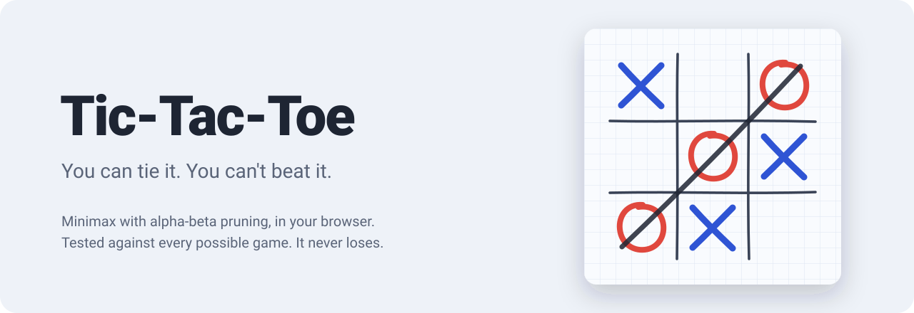

<p align="center">
  
</p>

<p align="center">
  <a href="https://chourouk5885.github.io/tic-tac-toe/"><b>▶ Play it now</b></a>
</p>

<p align="center">
  <a href="https://github.com/chourouk5885/tic-tac-toe/actions/workflows/deploy.yml"></a>
  
  
  <a href="LICENSE"></a>
</p>

Classic Tic-Tac-Toe against a computer that has looked at every possible game and knows the best reply to every move. On **Unbeatable**, the best you can do is a draw. Runs in any browser, on phones too, with no install.

## Features

- **An AI that never loses.** Minimax with alpha-beta pruning, proven by a test that plays out every possible game against it.
- **Three difficulty levels.** Easy plays randomly, Medium plays perfectly 60% of the time, Unbeatable always does.
- **See what the AI sees.** Turn on *Show AI thinking* and every empty square shows whether it leads to a win, a draw or a loss with perfect play.
- **Paper by day, chalkboard by night.** A graph-paper board with ink and red-pencil marks in light mode, chalk on a blackboard in dark mode. Follows your system setting, or pick one.
- **Hand-drawn feel.** The grid sketches itself in, marks draw stroke by stroke, and a pen line strikes through the winning row.
- **Play a friend** on the same device, or choose to go first or second against the computer.
- **Undo, scoreboard and saved settings**, all remembered between visits.
- **Keyboard and screen-reader friendly.** Arrow keys and Enter to play, every square is labelled, and turns and results are announced.
- **Optional sound effects**, synthesized in the browser with no audio files.

## Controls

| Action | Mouse / touch | Keyboard |
|---|---|---|
| Play a square | Click or tap | Arrow keys, then `Enter` or `Space` |
| New game | **New game** | `N` |
| Undo your last move | **Undo** | `U` |

## How the AI works

The computer uses **minimax**, a classic algorithm for two-player games.

For every move it could make, it plays the rest of the game out in its head, assuming you always answer with *your* best move. Finished games are scored from the computer's point of view:

| Result | Score |
|---|---|
| Computer wins | `+10 − moves taken` |
| Draw | `0` |
| Computer loses | `moves taken − 10` |

The scores flow back up the game tree. On its own turn the computer takes the **highest** score; on yours it assumes you'll pick the **lowest**. Counting the moves taken makes a fast win worth more than a slow one, so it finishes you off quickly and drags out any position it can't save.

Here is a tiny example. It's O's turn, and X is threatening the top row:

```
 X │ X │ ·        O plays top-right  → blocks; the game goes on → score 0
───┼───┼───       O plays anywhere else → X completes the row → score −8
 · │ O │ ·
───┼───┼───       Best guaranteed score: 0, so O blocks.
 · │ · │ ·
```

**Alpha-beta pruning** makes the search faster without changing the answer. While exploring, the AI remembers the best result each side is already guaranteed. As soon as a line of play is provably worse than an option already found, the rest of that line is skipped.

Tic-Tac-Toe is a draw when both sides play perfectly, so the AI can always secure at least a draw. The test suite proves it: it plays the Unbeatable AI against **every possible sequence of opponent moves**, as X and as O (16,752 complete games), and checks that it never loses once.

The code is in [`src/ai/minimax.ts`](src/ai/minimax.ts), with comments walking through each step.

## Run it locally

You need [Node.js](https://nodejs.org) 20 or newer.

```bash
git clone https://github.com/chourouk5885/tic-tac-toe.git
cd tic-tac-toe
npm install
npm run dev      # play at http://localhost:5173/tic-tac-toe/
npm test         # run the tests
npm run build    # type-check and build the site into dist/
```

## Project structure

```
src/
├── game/       board rules: moves, turns, wins and draws (no browser code)
├── ai/         minimax with alpha-beta pruning, and the difficulty levels
├── state/      settings and scoreboard, saved in localStorage
├── ui/         board rendering, animations, sound, theme
├── main.ts     ties it all together
└── styles.css  every colour for both themes lives at the top
tests/          Vitest tests for the rules and the AI
```

The game rules and the AI never touch the page, which is what makes them easy to test.

## Deployment

Every push to `main` runs the tests, builds the site and publishes it to GitHub Pages. If a test fails, nothing is deployed. The workflow is in [`.github/workflows/deploy.yml`](.github/workflows/deploy.yml).

## License

[MIT](LICENSE)
